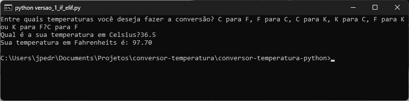
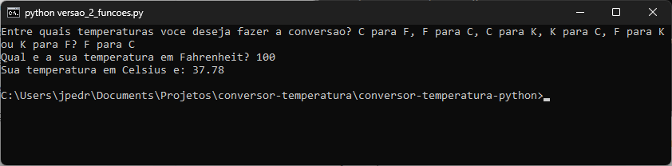

# Conversor de Temperatura

Um programa em Python que converte temperaturas entre Celsius, Fahrenheit e Kelvin.

## Objetivo
Automatizar o cálculo de conversão entre as principais escalas termométricas.

## Duas versões do programa

Este foi o meu primeiro projeto sozinho, para aprender lógica de programação e Python na faculdade. Deixei as duas versões aqui para mostrar a evolução:

| Arquivo | O que é |
|---|---|
| `versao_1_if_elif.py` | Primeira versão, do jeito que eu fiz no começo: um bloco `if/elif` para cada conversão, com a conta escrita dentro. |
| `versao_2_funcoes.py` | Versão evoluída: a conta de cada conversão virou uma função (ex: `celsius_para_fahrenheit`), e o `main()` só pergunta, chama a função certa e mostra o resultado. |

As duas fazem exatamente a mesma coisa: convertem entre Celsius, Fahrenheit e Kelvin nas seis direções (C para F, F para C, C para K, K para C, F para K e K para F).

**O que mudou da versão 1 para a 2:**
* Cada conta ganhou um nome que explica o que ela faz, e fica escrita em um lugar só.
* As funções podem ser reaproveitadas em outros programas.
* Ficou mais fácil achar e corrigir uma fórmula, sem mexer no resto do código.

## Tecnologias utilizadas
* Python 3
* Vs Code, Git e GitHub

## Como executar

### Pré-requisitos
* Python 3.x instalado ([python.org](https://www.python.org/))
* Git instalado ([git-scm.com](https://git-scm.com/))

### Passo a passo
1. Utilize o **Vs Code** com terminal integrado ou abra o próprio terminal/prompt de comando na sua máquina seguindo as instruções abaixo:

   * **Windows:** Pressione `Win + R`, digite `cmd` e aperte `Enter` (ou use o **PowerShell**/**Git Bash**)
   * **Linux/macOS:** Abra o aplicativo **Terminal**

2. Navegue até a pasta onde deseja salvar o projeto, copie a URL do repositório no GitHub e clone-o executando o comando:

   ```git clone https://github.com/jpedroferreira07/conversor-temperatura.git```

3. Acesse a pasta do programa:

   `cd conversor-temperatura`

4. Por fim, execute a versão que quiser (use `versao_1_if_elif.py` para a primeira):

   * **Windows:**`python versao_2_funcoes.py`

   * **Linux/macOS:**`python3 versao_2_funcoes.py`

## Prints do projeto

**Versão 1** (`versao_1_if_elif.py`), convertendo 36.5 °C para Fahrenheit:



**Versão 2** (`versao_2_funcoes.py`), convertendo 100 °F para Celsius:


